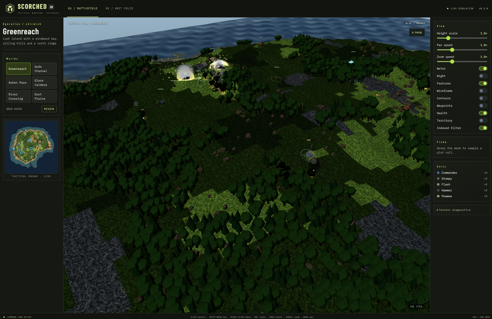

# Scorched 3D

Models used: _Grok 4.6_ (terrain), _Muse Spark 1.3_ (bulk of the logic), _GPT 6.1 Sol_ (advanced logic, unit models)

Scorched 3D is a browser game showing a live battle between two armor teams.

Blue team starts in the west. Orange team starts in the east. You give no orders. The battle runs by itself.

Each unit moves on a patrol route. Each unit looks for the enemy. When a unit sees the enemy, it turns toward the target. Then it aims its gun and fires.

When a shell lands near a unit, the blast shakes the unit. The unit turns to face the shooter. Then it returns fire. It follows the enemy to stay in range. If the enemy force is too strong, the unit holds position and waits for help.

Each team owns one factory. The factory opens its door. Then it sends a new unit to the battle. Weak units come more often. Strong units take more time to build. Holding more ground speeds up the factory. If enemy fire destroys the factory, it sends no more units.

Every shot changes the field. Each blast burns the ground and leaves a black mark. Trees catch fire and the fire spreads to near trees. Rocks break to rubble. Wrecked units burn, sink into the ground, and disappear.

The battle has sound. Guns crack and shells thump, blasts boom, and zooming in makes it louder. The Sound panel holds mute and volume.

## Start the game

Do these steps to start the game:

1. Install the Node version from `.nvmrc`.
2. Run `yarn install`.
3. Run `yarn build` one time.
4. Run `yarn dev`.
5. Open the shown URL in your browser.
